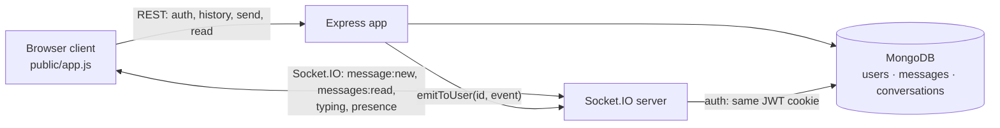

# Realtime Chat

[](https://github.com/akhilreddy20/realtime-chat-backend/actions/workflows/ci.yml)

One-to-one real-time chat: **Express 5 · Socket.IO · MongoDB · JWT (httpOnly cookie)**, plus a dependency-free web client served by the same server.

**Features:** sign up / log in · contacts with online status, last message and unread count · live delivery to every open tab · typing indicator · read receipts (✓ / ✓✓) · "last seen" · paginated history · retry-safe sends · optional image messages and avatars (Cloudinary).

## Architecture



- **Writes go through REST, pushes go through Socket.IO.** A message is persisted, then pushed to the `user:<id>` room of both participants. REST gives status codes, validation, rate limiting and retries; the socket only fans out.
- **Rooms per user, not one socket per user.** Every tab and device of a user joins `user:<id>`, so all of them get new messages. Presence counts sockets: a user is online while at least one tab is open.

## Key design decisions

| Decision | Why | Trade-off |
|---|---|---|
| **Idempotent sends.** The client creates a `clientMessageId` and retries with the same id. A unique index on `(senderId, clientMessageId)` makes duplicates impossible; a replay returns the stored message with `200 Idempotent-Replayed: true` and is **not** re-broadcast. | Flaky mobile networks retry. Without this, one tap can become two messages. Covered by a test that fires 20 concurrent sends with one id. | Keys are kept forever (they're tiny); a TTL would bound that. |
| **Cursor pagination on `_id`** (`?before=<id>&limit=30`), with index `{conversationId: 1, _id: -1}` | Stable while new messages arrive (offset pagination skips or repeats rows). Each page is an index range scan. | Can't jump to page N (chat doesn't need that). |
| **Denormalized `Conversation.lastMessage`** | The contacts list reads one small document per conversation instead of scanning all of a user's messages. Updated with a conditional write (`lastMessage._id < new._id`), so out-of-order completions can't move it backwards. | One extra write per message. |
| **Socket handshake uses the same JWT cookie as REST** | The original trusted `?userId=` from the query string, so anyone could connect as anyone. | Non-browser clients pass `auth.token` instead. |
| **httpOnly + `SameSite=Strict` cookie, same-origin client** | JS can't read the token (XSS) and other sites can't use it (CSRF). | A client on another origin must use `Authorization: Bearer`. |
| **In-memory rate limits** (login 20 / 15 min per IP+email; sends 30 / 10 s per user; typing 10 / s per socket) | Stops brute force and spam without new infrastructure. | Per instance. See *Scaling*. |

## Running locally

```bash
# Option A: Docker (MongoDB + app)
docker compose up --build            # http://localhost:5001

# Option B: manual
cp .env.example .env                 # set MONGODB_URI and JWT_SECRET
npm ci
npm run dev                          # http://localhost:5001
```

Open two browsers (or a normal and a private window), sign up as two users and chat.

## API

| Method | Path | Notes |
|---|---|---|
| POST | `/api/auth/signup` | `{ fullName, email, password }` → 201 + session cookie |
| POST | `/api/auth/login` | `{ email, password }` → 200 / 401; rate limited |
| POST | `/api/auth/logout` | clears the cookie |
| GET | `/api/auth/me` | current user |
| PATCH | `/api/auth/profile` | `{ fullName?, profilePic? (data URL) }` |
| GET | `/api/users` | contacts + `online`, `lastMessage`, `unreadCount`, most recent first |
| GET | `/api/messages/:userId?before=&limit=` | `{ messages (oldest→newest), nextCursor }` |
| POST | `/api/messages/:userId` | `{ text?, image?, clientMessageId? }` → 201 created / 200 replayed |
| POST | `/api/messages/:userId/read` | marks their messages to me as read → `messages:read` to them |
| GET | `/health` | 200 when MongoDB is connected, else 503 |

**Socket events.** Server → client: `presence:online` (ids), `presence:update {userId, online, lastSeenAt?}`, `message:new`, `messages:read {by, ids, readAt}`, `typing {from, isTyping}`. Client → server: `typing {to, isTyping}`.

## Tests

```bash
npm test                                                        # unit tests
docker run -d -p 27017:27017 mongo:7
MONGODB_URI_TEST=mongodb://localhost:27017/chat_test npm test   # + end-to-end
```

The end-to-end suite (Node 22+) starts the real HTTP + Socket.IO server and drives it with `fetch` and the Socket.IO client that ships inside the `socket.io` package, so it needs no extra dependencies. It covers:

- cookie flags and auth errors (401, not 500)
- validation and rate limiting
- pagination with no gaps or duplicates
- concurrent idempotent sends
- socket auth, including the old `?userId=` impersonation
- delivery to every tab, with no leaks to third parties
- typing, read receipts and unread counts
- multi-tab presence

CI runs it against MongoDB 7 and builds the Docker image.

## Scaling beyond one instance

These are the next steps, not implemented here:

1. **Socket.IO Redis adapter**, so `emitToUser` reaches sockets connected to other instances.
2. **Presence in Redis** (`SADD user:<id>:sockets`, with TTL heartbeats), because the in-memory registry is per process.
3. **Rate limits in Redis** (`INCR` + `EXPIRE`).
4. **Outbox or change streams**, so a crash between "message saved" and "event emitted" can't drop a push. Clients already re-sync on reconnect, which covers this case today.

## Changes from the original version

The first version had bugs that broke it end to end:

- `object.keys` crashed every socket connection
- `cloudinary` was used but never imported
- `timeStamps` was misspelled, so messages had no `createdAt`
- `res.ststus` was a typo
- the profile-update route was empty
- the socket accepted any `?userId=`
- CORS pointed at `https://localhost`
- a second tab overwrote the first tab's socket
- expired tokens returned 500

All of these are fixed and covered by tests.
